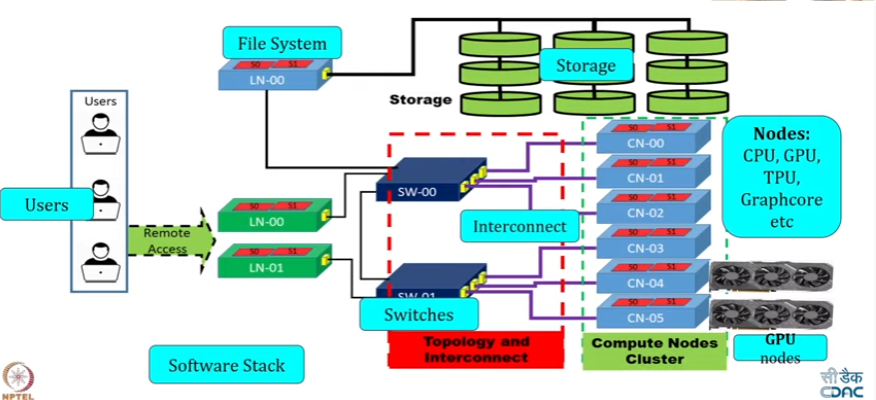

# Operating Systems
*Created on:* 2025-01-22  
*Tags:* #OperatingSystems
*Course:* [[HPC]]

---
## Definition

An operating system is a software that manages hardware and software resources on a computer.

- The most important program that runs on your computer.
- It manages all other programs on the machine.
- Its the first thing loaded on the your Computer.
- W/O operating system, a computer cannot function effectively. 

## Components of Operating System

1. Kernel: Heart of the OS. 
	1. Acts as a bridge the hardware and software.
	2. Process Management
	3. Memory Management
	4. Device Management
2. Process Management: The component handles the creation, scheduling and termination of processes i.e. running programs.
	1. Multitasking
	2. CPU Scheduling
	3. Process Synchronization
3. Memory Management: Ensures efficient memory usage.
	1. Memory Allocation
	2. Paging/Segmentation
	3. Memory Protection
4. File System Management
	1. File creation and deletion
	2. Access Control
	3. Organization
	4. Storage
5. Device Management: Manages communication between the OS and hardware.
	1. Device Drivers
	2. I/O Management
	3. Buffering and Spooling: Temporarily stores data.
6. User Interface: Provides a way for users to interact with the system.
	1. GUI
	2. CLI
7. Security and Access Control: Ensures the system is protected.
	1. Authentication
	2. Authorization
	3. Encryption
	4. Firewalls
8. Networking: Manages networking protocols.
	1. Data Transmission
	2. Network Security
	3. Resource Sharing

## Types of OS

1. **Single User, Single Task**: Designed to execute a single task efficiently at a time.
2. **Real Time Operating System (RTOS)**: Designed to handle applications that require precise timing and immediate processing of tasks.
3. **Single User, Multi-tasking**: Common is personal computers, laptops, smartphones.
4. **Multi-user, Multi-tasking:** Multiple users to access and work on the system simultaneously. Each user has their session and environment. Widely used in servers/HPC.

## Linux OS

- Popular, Open-source OS
- Versatility, Security and Stability.
- Linux has roots in UNIX.
- Most popular OS.
- It is the heart of HPC systems.
- Customizable and Flexible.
-  Shell --> System Libraries --> Kernel

