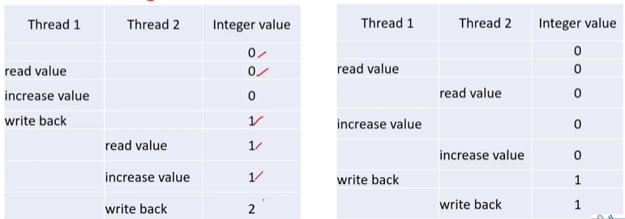
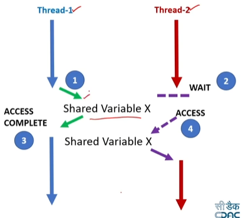

# Synchronization 
*Created on:* 2025-02-04  
*Tags:* #Synchronization
*Course:* [[HPC]]

---
## Definition

- Sequential programs involves execution of instructions in an order one after another as dictated by the programmer.
- Supercomputers use parallel programming techniques to achieve higher performance.
- Parallel programs make use multiple CPU cores, with each core performing a task independently.
- However, these task may be required to interact with each other.
- Concurrency allows multiple tasks of a program to run on a single CPU core.
	- The core switches between these tasks which actually are threads.
- Execution of these threads is interleaved over time, because the CPU core can execute only thread at a time.
- A system with multiple cores, can run the threads in parallel, because the system can assign a separate thread to each core.

## Data Races

- Race condition occurs when two thread try to access the same variable at the same time.
- This is likely to cause sometimes.
- The result of a computation becomes
	- Indeterminate
	- Inconsistent
- The value of a computation depends on the order of execution of multiple processes or threads.
	- The output is determined by which thread finishes last.
	- However, it is very difficult to know which thread would finish last.

- The order of execution of the threads change the result.

## Synchronization

- Allows access of a variable to a thread at a time.
- Use of Lock and Key
- Affects the performance because the other thread has to wait.
- Minimize the amount of synchronization is desirable by restructuring the code/algorithm.
- Contention-Only Threads: Only share cache but don't share the cache.
- Data-Sharing Threads: Threads share data.
- Critical Section: Another method implement synchronization.
	- Once a thread enters its CS, does its job and exits CS, only then any other thread can enter its own CS for the same variable.
	- Lock mechanism is used for non-interruption of a critical section.
	- This ensures exclusive access to the shared resource.
	- Mutex means Mutual Exclusion.
	- A mutex lock uses "lock" and "unlock" functions to protect critical section.
- Atomics: Instructions that execute without any interruption.
	- Atomics operations are performed on a memory location.
- Barrier : All threads must wait at some point. It is synchronization mechanism.

