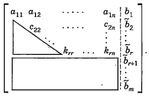

# System of Equations
*Created on:* 2024-12-20  
*Tags:* #SytemofEquations
*Course:* [[Linear Algebra]]

---
## Definition

A linear system of $m$ equations in $n$ unknowns $x_{1},x_{2},x_{3},\dots,x_{n}$ is a set of equations of the form
$$
\begin{gathered}
a_{11}x_{1} + \dots + a_{1n}x_{n} = b_{1}\\
a_{21}x_{1} + \dots + a_{2n}x_{n} = b_{2}\\
\dots\\
a_{m1}x_{1} + \dots + a_{mn}x_{n} = b_{m}\\
\end{gathered}
$$

The system is called homogenous if the value of $b_{j}$ is zero otherwise it is known as non-homogenous.

A solution of the linear system is a set of number $x_{1},x_{2},x_{3},\dots,x_{n}$ that satisfies all the $m$ equations.

## Matrix form

The system can be represented using a single vector equation
$$
Ax = b
$$
Here, 
1.  $A$ is the coefficient matrix of size $m\times n$.
2. $x$ is the solution vector of size $n\times 1$.
3. $b$ is the RHS vector of size $m\times1$

$$
A = \begin{bmatrix}
a_{11} & a_{12} & \dots & a_{1n}\\
a_{21} & a_{22} & \dots & a_{2n} \\
. & . & \dots & .\\
a_{m1} & a_{m2} & \dots & a_{mn}
\end{bmatrix},\,\,\text{and}\,\,
x = \begin{bmatrix}
x_{1} \\
x_{2} \\
. \\
. \\
. \\
x_{n}
\end{bmatrix}\,\, \text{and}\,\,
b = \begin{bmatrix}
b_{1} \\
. \\
. \\
. \\
b_{m}
\end{bmatrix}
$$

## Types of System

1. **Determined**: If the number of equations and the number of variables are equal.
2. **Underdetermined:** If the number of equations is less than the number of variables.
3. **Overdetermined:** If the number of equations is more than the number of variables.
4. **Consistent:** If the system has at least one solution.
5. **Inconsistent:** If the system has no solution.

## Gauss Elimination

Row operations are used to obtain a triangular system and back substitution is used to obtain the solution.

*Row echelon form:* The coefficient matrix at the end of the Gauss elimination.
1. If rows of zero are present, are the last rows.
2. In each non-zero row, the leftmost non-zero entry is farther to the right than in the previous row.

Example,
$$
\begin{bmatrix}
3 &2 &1 \\
0 &1 &4 \\
0 &0 &0
\end{bmatrix}
$$
#### Row operations

1. Interchange of two rows
2. Addition of a constant multiple of one row to another row
3. Multiplication of a row by a non-zero constant.

#### Possible Cases of Solution

1. **Exactly one solution:** If $r=n$ and $\bar{b}_{r+1}, \dots,\bar{b}_{m}$, if present are zero.
2. **Infinitely many solution:** If $r<n$ and $\bar{b}_{r+1}, \dots,\bar{b}_{m}$, if present are zero.
3. **No Solution:** If $r<n$ and one of the entries $\bar{b}_{r+1}, \dots,\bar{b}_{m}$, is not zero.

## Cramer's Rule

The solution of a system of linear equations can be found using Cramer's rule. It states that

$$
x_{k} = \frac{D_{k}}{D} 
$$
Where,
1. D is the determinant of the coefficient matrix.
2. $D_{k}$ is the determinant matrix but the $k^{th}$ column is replaced with the RHS vector.
$$
D_{k} = \begin{vmatrix}
a_{11} & a_{12} & \dots & b_{1} & \dots & a_{1n}\\
a_{21} & a_{22} & \dots & b_{2} & \dots & a_{2n}\\
. & . & \dots & . & \dots & .\\
a_{n1} & a_{n2} & \dots & b_{n} & \dots & a_{nn}\\
\end{vmatrix}
$$

For a homogenous system, if $D=0$, then the system has non-trivial solutions.
