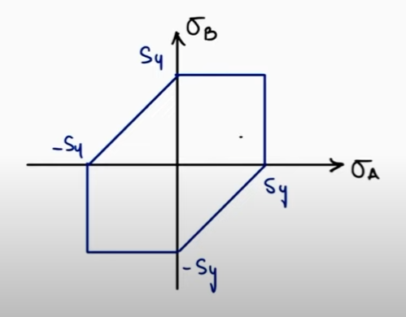

# Failure Theories 
*Created on:* 2025-01-30  
*Tags:* #FailureTheories
*Course:* [[MOS]]

---
## Maximum Shear-Stress Theory/Tresca Yield

- The theory results from the observation that in a ductile materials slip occurs during yielding along the critically oriented planes.
- Whenever a certain critical value $\tau_{cr}$ is reached yielding in an element commences. Thus,

$$
\tau_{max} \le \frac{\sigma_{yp}}{2}
$$
- In 3D, usually $\sigma_{z}$ is zero. Therefore, we have three cases depending on the value of $\sigma_{1}$ and $\sigma_{2}$. The value of overall maximum shear stress is considered instead of the in plane maximum shear stress.

### Case 1: Both Positive

- $\sigma_{1}$ and $\sigma_{2}$ are non-zero and positive. 
- $\sigma_{3}=0$.
- $\sigma_{1}\geq \sigma_{2}\geq \sigma_{3}$ .
- Then, the value of $\tau_{max}$ is given as 
$$
\tau_{max} = \frac{\sigma_{1}}{2} \leq \frac{\sigma_{yp}}{2}
$$
### Case 2: One positive and one negative

- $\sigma_{1}$ and $\sigma_{3}$ are non-zero. 
- $\sigma_{1}>0$ whereas $\sigma_{3}<0$.
- $\sigma_{2}=0$. 
- $\sigma_{1}\geq \sigma_{2}\geq \sigma_{3}$ .
- Then, the value of $\tau_{max}$ is given as
$$
\tau_{max} = \frac{\sigma_{1}-\sigma_{3}}{2} \leq \frac{\sigma_{yp}}{2}
$$
### Case 3: Both Negative

- $\sigma_{2}$ and $\sigma_{3}$ are non-zero. 
- $\sigma_{2}<0$ and $\sigma_{3}<0$.
- $\sigma_{1}=0$. 
- $\sigma_{1}\geq \sigma_{2}\geq \sigma_{3}$ .
- Then, the value of $\tau_{max}$ is given as
$$
\tau_{max} = \frac{\sigma_{1}-\sigma_{3}}{2} \leq \frac{\sigma_{yp}}{2}
$$

From all the cases, we have

$$
\sigma_{1}-\sigma_{3} \leq \sigma_{yp}
$$
The factor of safety $(n)$ can be defined as 
$$
n = \frac{\sigma_{yp}}{\sigma_{1}-\sigma_{3}}
$$
- $\sigma_{A}$ and $\sigma_{B}$ are the in plane stresses.

- Point inside the hexagon indicate that a material behaves elastically.
- Point on the boundary, begins and continues to yield.
- No stress points can lie outside the hexagon.

## Maximum Distortion-Energy Theory

- The total elastic energy is divided into two parts: hydrostatic and deviatoric.
- Strain energy per unit volume > Yield Strain energy 
- Hydrostatic: Associated with the volumetric changes of the material (1st Matrix).
- Deviatoric: Causing shear distortions (2nd Matrix).
$$
\begin{pmatrix}
\sigma_{1} & 0 & 0\\
0 & \sigma_{2} & 0\\
0 & 0 & \sigma_{3}
\end{pmatrix} = \begin{pmatrix}
\bar{\sigma} & 0 & 0\\
0 & \bar{\sigma} & 0\\
0 & 0 & \bar{\sigma}
\end{pmatrix}
+
\begin{pmatrix}
\sigma_{1}-\bar{\sigma} & 0 & 0\\
0 & \sigma_{2}-\bar{\sigma} & 0\\
0 & 0 & \sigma_{3}-\bar{\sigma}
\end{pmatrix}
$$
- The total energy in terms of principal stresses is
$$
U_{0} = \frac{1}{2E}(\sigma_{1}^2 + \sigma_{2}^2 + \sigma_{3}^2) - \frac{\nu}{E}(\sigma_{1}\sigma_{2} + \sigma_{2}\sigma_{3} + \sigma_{3}\sigma_{1})
$$
- The hydrostatic energy is given as
$$
U_{sph} = \frac{1-2\nu}{6E}(\sigma_{1} + \sigma_{2} + \sigma_{3})^2
$$
- The deviatoric energy is given as
$$
U_{dev} = \frac{1}{12G}[(\sigma_{1}-\sigma_{2})^2 + (\sigma_{2}-\sigma_{3})^2 + (\sigma_{3}-\sigma_{1})^2]
$$
- This gives the yield criterion as 
$$
\sigma_{VM}^2 = (\sigma_{1}-\sigma_{2})^2 + (\sigma_{2}-\sigma_{3})^2 + (\sigma_{3}-\sigma_{1})^2 = 2 \sigma^2_{yp}
$$
- This is also known as von Mises yield criteria and the stress is known as von Mises stress.
- The factor of safety $(n)$ is given as
$$
n = \frac{\sigma_{yp}}{\sigma_{VM}}
$$
