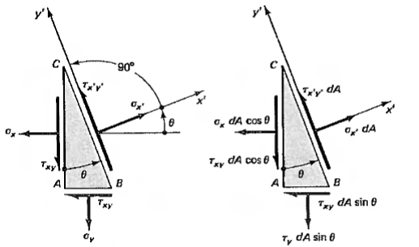
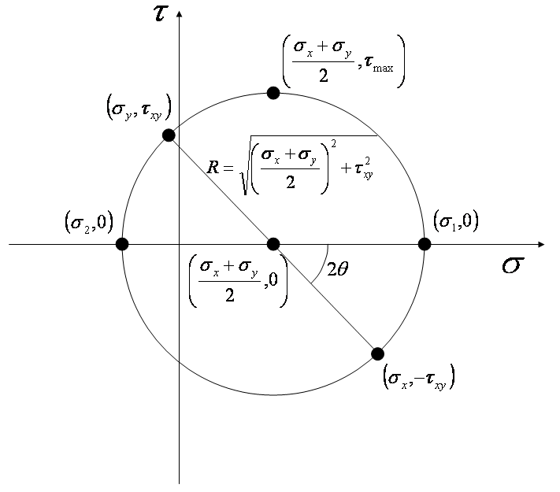

# Mohr's Circle 
*Created on:* 2025-01-30  
*Tags:* #MohrsCircle
*Course:* [[MOS]]

---
## Transformation of Stress in 2-D Problems

- The stress transformation is sought from the $xy$ coordinate axes to the $x'y'$ axes. 
- The angle between the $x$ and $x'$ is $\theta$  (Positive in CCW).

- Balancing the forces in $x'$ and $y'$ direction, we get
$$
\sigma_{x'} = \frac{\sigma_{x}+\sigma_{y}}{2} +  \frac{\sigma_{x}-\sigma_{y}}{2}\cos 2\theta + \tau_{xy} \sin 2\theta
$$$$
\tau_{x'y'} = - \frac{\sigma_{x}-\sigma_{y}}{2}\sin 2\theta + \tau_{xy} \cos 2\theta
$$
$$
\sigma_{y'} = \frac{\sigma_{x}+\sigma_{y}}{2} -  \frac{\sigma_{x}-\sigma_{y}}{2}\cos 2\theta + \tau_{xy} \sin 2\theta
$$

- The first two equations form a circle in $\sigma_{x'}$ and $\tau_{x'y'}$.

## Principal Stresses

- The maximum and minimum normal stress are known as the principal stresses.
- The planes on which they exist can be found using
$$
\tan 2\theta_{*} = \frac{2\tau_{xy}}{\sigma_{x}-\sigma_{y}}
$$
- The shear stress on this planes is zero.
- They are represented using $\sigma_{1}, \sigma_{2}$ and $\sigma_{3}$.
$$
\sigma_{ij} = 
\begin{pmatrix}
\sigma_{1} & 0 & 0 \\
0 & \sigma_{2} & 0 \\
0 & 0 & \sigma_{3}\\
\end{pmatrix} 
$$
- They are the eigenvalues of the general stress matrix.

