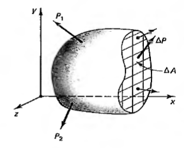
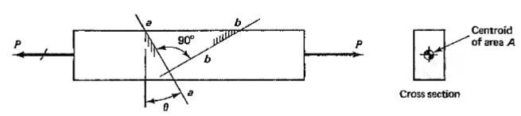
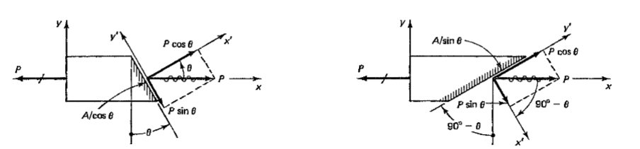

# Stress and Strain 
*Created on:* 2025-01-30  
*Tags:* #Stress #Strain
*Course:* [[MOS]]

---
## Stress

- Forces acting on infinitesimal areas with varying magnitudes and cuts.
- They vary from point to point and are inclined with respect to the plane of the section.
- For example the components of a force vector $\Delta P$ acting on an area $\Delta A$ is shown in the diagram.

- The direction of $\Delta A$ is in the positive $x$ direction whereas the force $\Delta P$ can be resolved in the directions $x,y$ and $z$.
$$
\sigma_{xx} = \lim_{ \Delta A \to 0 } \frac{\Delta P_{x}}{\Delta A} 
$$
$$
\tau_{xy} = \lim_{ \Delta A \to 0 } \frac{\Delta P_{y}}{\Delta A} 
$$
$$
\tau_{xz} = \lim_{ \Delta A \to 0 } \frac{\Delta P_{z}}{\Delta A} 
$$

- The intensity of force perpendicular to the section is called *normal stress* at a point. They are designated by $\sigma$.
- The intensity of force acting parallel to the plane of the section are called *shear stress*. They are designated by $\tau$.
- The value of stress varies in different set of coordinate axes. The process of changing stresses from one set of coordinate axes to another is termed as stress transformation.
- The stress ($\sigma_{ij}$) is a second-rank tensor quantity i.e. one magnitude and two directions.
$$
\sigma_{ij} = 
\begin{pmatrix}
\sigma_{xx} & \tau_{xy} & \tau_{xz} \\
\tau_{yx} & \sigma_{yy} & \tau_{yz} \\
\tau_{zx} & \tau_{zy} & \tau_{zz}
\end{pmatrix}
$$
- $\sigma_{ij} = \sigma_{ji}$ due to equilibrium conditions.

## Stress Analysis of Axially loaded bars

Stresses on the section $a-a$:
$$
\sigma_{\theta} = \frac{P}{A} \cos^2\theta\,\,\text{and}\,\,
\tau_{\theta} = - \frac{P}{A}\cos \theta \sin \theta
$$
Stresses on the section $b-b$:
$$
\sigma_{\theta-90} = \frac{P}{A} \sin^2\theta\,\,\text{and}\,\,
\tau_{\theta-90} = \frac{P}{A}\cos \theta \sin \theta
$$
Now, the normal and shear stress vary with $\theta$ and the maximum normal stress is achieved at $\theta=0$, where
$$
\sigma_{max}=\frac{P}{A} = \sigma_{x}
$$
The maximum shear stress is obtained at $\theta=\pm 45^{\circ}$
$$
\tau_{max} = \frac{P}{2A} = \frac{\sigma_{x}}{2}
$$

## Analysis of Stresses

- The deformation in engineering structures are negligible as compared to their dimension, hence the original undeformed dimension of members are used in computations.
- The governing equations/conditions for equilibrium of a structure are
$$
\begin{gathered}
\sum F_{x} = 0\\
\sum F_{y} = 0\\
\sum F_{z} = 0\\
\sum M_{x} = 0\\
\sum M_{y} = 0\\
\sum M_{z} = 0
\end{gathered}
$$

- If the equations of statics suffice for determining the external reactions as well as the internal statics stress resultants, a structural system is statically determinant.
- Otherwise, it is statically indeterminant.

## Strain

- *Normal Strain*: Strain associated with normal stress. Also known as engineering strain.
$$
\varepsilon = \frac{L-L_{0}}{L_{0}} = \frac{\Delta L}{L_{0}}
$$
- *True Strain:* The strain increment $d\varepsilon$ is defined as $dL/L$, where L is the instantaneous length of the specimen.
$$
\bar{\varepsilon} = \int_{L_{0}}^L \frac{dL}{L} = \ln\left( \frac{L}{L_{0}} \right) = \ln(1+\varepsilon)
$$
- For small strains, the value of engineering strain and true strain agree but for applications with large strain, they differ.
- They are measured using strain gauges.
- *Engineering Stress:* Stress calculated using the original area of a specimen.
- *True Stress*: Stress calculated using the instantaneous area of the specimen. 