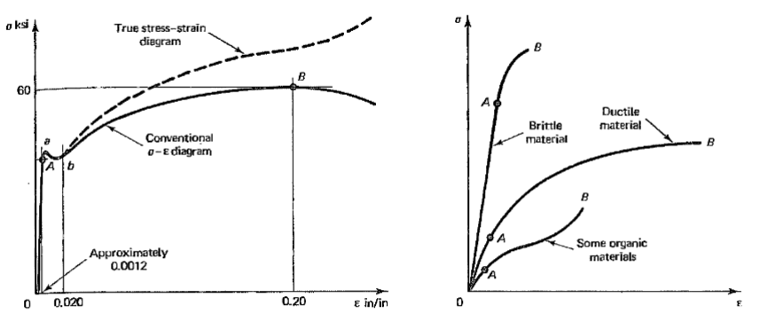

# Stress-Strain Relationship 
*Created on:* 2025-01-30  
*Tags:* #Stress-Strain #Relationship
*Course:* [[MOS]]

---
## Definition

- The terminal point on a stress-strain diagram represents the complete failure (rupture) of specimen.
- *Ductile Material*: Capable of withstanding large strains without significant increase in stress.
- *Brittle Material*: Doesn't withstand large strains without significant increase in stress.
- A plot of true stress v/s true strain is known as true stress-strain diagram.
- Hooke's law is valid up to the point A.
- The highest value of stress (B) is known as the *ultimate strength of a material*.
- The stress associated with the long plateau ab is called the yield strength of a material. Here, a large deformation is observed for a constant stress.

