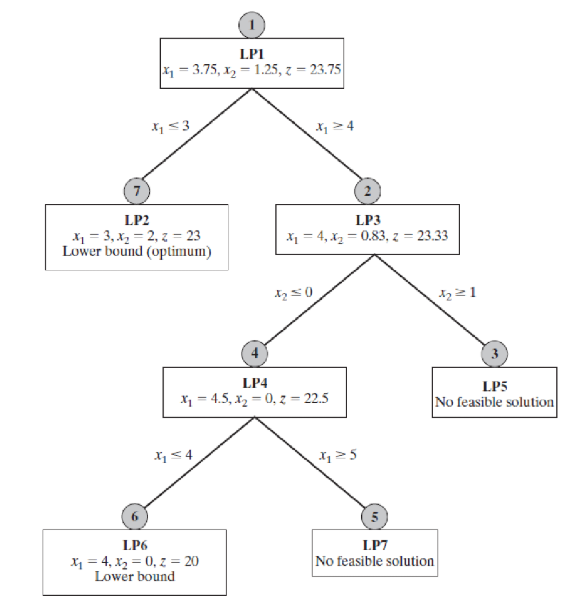

# Branch and Bound Method 
*Created on:* 2024-12-08  
*Tags:* #BranchandBoundMethod
*Course:* [[Optimization]]

---
## Definition

*Branch and Bound Problem* works by dividing the problem into smaller subproblems, or branches, and then eliminating certain branches based on bounds on the optimal solution. This process continues until the best solution is found or all branches have been explored.

**Rules**
1. Start branching with the variable having highest fractional value.
2. Solve the branches with the new constraints using linear-programming methods.
3. If the solution of any branch say $LP_{3}$ is non-integer, we again branch and solve the problem with the new constraint.
4. The branch with best Z is chosen as the solution.

