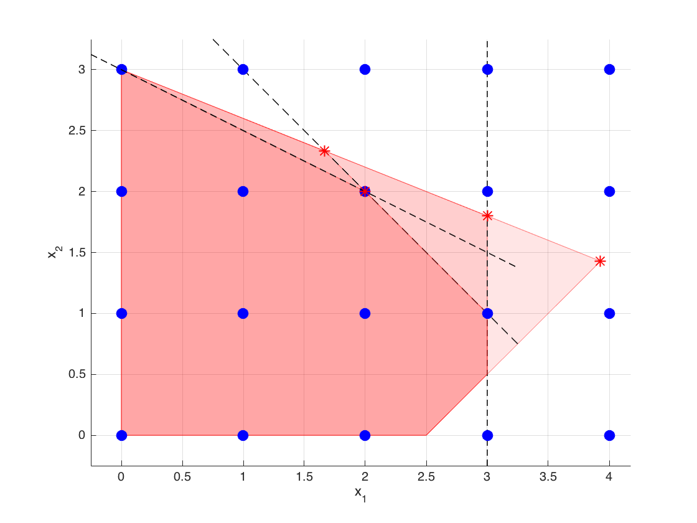

# Gomory's Cutting Plane Method
*Created on:* 2024-12-07  
*Tags:* #CuttingPlaneMethod
*Course:* [[Optimization]]

---
## Definition

Gomory's Cutting Plane Method finds a hyperplane with the real optimal solution on one side and all feasible integer points on the other.

### Method

1. Solve the LP without the requirement of variables to be integers.
2. If the solution is not integer, select a constraint with highest fraction in RHS. If all constraints have same value, then select anyone. For example,
$$
x_{1} + \frac{1}{7}s_{2} - \frac{1}{7}s_{3} = 4 \frac{4}{7}
$$
3. Separate the integer and fraction part such that all fraction parts are positive.
$$
x_{1} - s_{3} + \frac{1}{7}s_{2} + \frac{6}{7}s_{3} = 4+ \frac{4}{7}
$$
4. Taking all integers to LHS and all fractions to RHS.
$$
x_{1} - s_{3} -4 = - \frac{1}{7}s_{2} - \frac{6}{7}s_{3} +\frac{4}{7}
$$
5. The RHS is always less than 0 since the variables are zero and the equation has to be integer.
$$
\frac{1}{7}s_{2} - \frac{6}{7}s_{3} +\frac{4}{7} \le 0
$$
6. The above equation is the fractional cut. Solve the LP including this new constraint. 