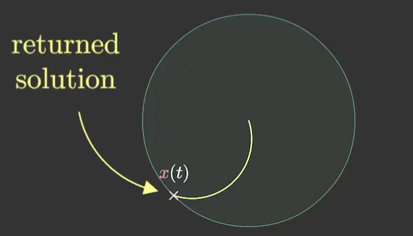

# Penalty Functions 
*Created on:* 2024-12-08  
*Tags:* #PenaltyFunctions
*Course:* [[Optimization]]

---
## Definition

Penalty Function methods are used to solve constrained NLP which reduces the problem into a series of unconstrained optimization problems.

They use unconstrained optimization techniques like Cauchy's method, DFP, BFGS, FR, etc.

There are two types of penalty functions:
1. Interior penalty functions
2. Exterior penalty functions

**Interior penalty functions**
Here, the Kuhn Tucker necessary conditions are modified to,

$\nabla f(x) + u\,\nabla g(x) = 0$
$g(x) \le 0$
$u \ge 0$
$u\,g(x) = -t$

Using the modified conditions, we can obtain
$$
\nabla(f - t\log(-g(x))) = 0
$$
Thus, the constrained problem can be transformed as a unconstrained problem i.e.
$$
\text{Minimize}\,\,\, f(x) - t\,\log(-g(x))
$$
This can be solved using the unconstrained optimization techniques. The unconstrained minima lies in the feasible region and converges to the solution as $t$ is varied.

**Algorithm**
1. Select a large value of $t$, which boils down the problem to minimization of $g(x)$. Since, $f(x) < t\log(-g(x))$ for very large value of $t$.
2. Solve the problem for that value of $t$.
3. Obtain the value of $x(t)$.
4. Now, take $t_{i+1} = c\,t_{i}$, where $c$ is a number between 0 and 1.
5. Go to step 2 and continue till $\Delta f(X_{i})\%<\epsilon$, where $\epsilon$ is a very small positive number.

**Exterior Penalty functions**

Using the modified conditions, we can obtain
$$
\nabla(f + t\,(max[\,0,\,g(x)\,])^2) = 0
$$
Thus, the constrained problem can be transformed as a unconstrained problem i.e.
$$
\text{Minimize}\,\,\, f(x) + t\,(max[\,0,\,g(x)\,])^2
$$
This can be solved using the unconstrained optimization techniques. The unconstrained minima lies in the infeasible region and converges to the solution as $t$ is varied.

**Algorithm**
1. Select a small value of $t$.
2. Solve the problem for that value of $t$.
3. Obtain the value of $x(t)$.
4. Now, take $t_{i+1} = c\,t_{i}$, where $c$ is a number greater than 1.
5. Go to step 2 and continue till $\Delta f(X_{i})\%<\epsilon$, where $\epsilon$ is a very small positive number.
