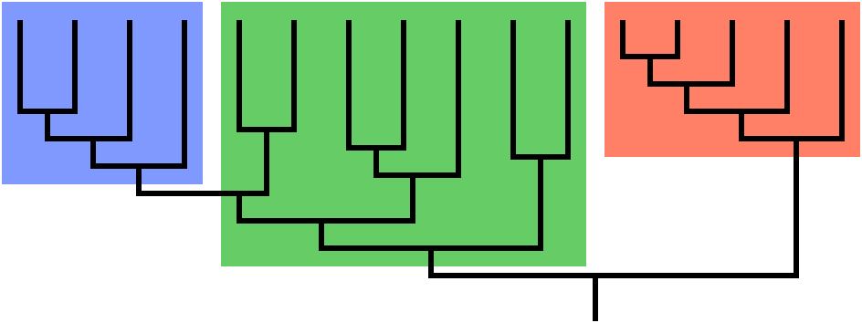
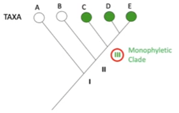

# Avian Diversity and Classification
*Created on:* 2025-01-02  
*Tags:* #Diversity #Classification
*Course:* [[Ornithology]]

---
## Taxonomy

- Taxonomy used to be the science of classification based on studying museum specimens.
- With arrival of genetic tools and techniques, molecular taxonomy has taken over.
- It is known as *systematics*.

### Advantages of Classification

- To understand diversification of birds and their evolutionary relationships.
- To study the roles of 'ecology v/s history' in evolution of bird assemblages and communities.
- To develop morphological, vocal, and behavioral cues for bird identification in field.
- To assess true conservation status of evolutionary distinct taxa.

### Past of bird taxonomy

- Comparative morphology and anatomy: Taxonomy based on similarities and dissimilarities.
- 40 taxonomic characters developed by H.F. Gadow in 1892 still remain the gold standard for bird classification.
- Some characters: Palate type, pelvic musculature, deep plantar tendons, intestinal convolutions, carotid arteries, and the fifth secondary.

### Present of bird taxonomy

- *Egg white protein electrophoresis*: a molecular technique to ascertain evolutionary relationships between taxa and to infer taxonomic relationships.
- *DNA-DNA hybridization*: A technique used to compute genetic similarity between a given pair of bird taxa.
- Gene sequencing method used for molecular phylogeny.

### Future of bird taxonomy

- Results from molecular evidences or techniques are not very reliable and robust.
- Multiple gaps in gene sequencing for taxonomy.
- A combination of all evidences: morphology, anatomy, genetic, behavior, ecology, and phylogeography.

### Classification Tree

- Class (Birds) --> Order --> Family --> Genus --> Species
- 44 Orders, ending in 'formes'.
- Suffix of family --> 'dae'
- Species is written as a combination of both genus and species names, known as binomial nomenclature.
- As per international code for zoology nomenclature, species is the most basic unit. But in some taxa including birds, species are often ground into subspecies or races. 
- The division of tree is done due to degree of evolutionary relationships.

### Homology

- True similarity in traits with common ancestry.
- Most useful in taxonomy
- *Synapomorphy*: shared primitive.
- *Symplesiomorphy*: shared derived.
- Example: Little Spiderhunter and Purple Sunbird
### Homoplasy

- False similarity in a trait between two taxa.
- Convergence in traits with NO common ancestry
- NOT to be used in taxonomic classifications.
- Traditional taxonomy fails to detect this convergence.
- Example: Bee Hummingbird and Purple Sunbird

### Clade

Any group of organisms believed to comprise all the evolutionary, descendants of a common ancestor is known as clade.

The tree diagram is known as cladogram. Each clade starts with a common node in the cladogram i.e. a common ancestor.

## Monophyly

- Group of taxa comprising of an ancestral taxon and ALL of its descendants.

### Paraphyly

Group of taxa in which one or more descendants of an ancestral species are left out.

### Polyphyly

Taxa that are separated from each other by more than two ancestors are placed together in a group. 

### Species

- Fundamental unit of biodiversity and classification.
- Biological Species Concept (BSC): Populations that breed amongst themselves, but are reproductively isolated from others.
- BSC can be applied to asexual or geographically isolated taxa.
- Phylogenetic Species Concept (PSC): Diagnosably distinct population showing common ancestral descent.
- Hybrid approach: BSC with adoption of PSC in diagnosably distinct species.

**Polymorphism**
Some species show remarkable 'color or plumage morphs', often considered as distinct sub-species or sometimes even species.
- They often co-occur
- They interbreed
- Morphs seem to be inherited and genetic not fully understood.
- Thought to be an offshoot of 'disruptive selection'
- Particularly common in raptors, seabirds, cuckoos, etc.

**Cryptic species**

Two or more species that look morphologically similar, yet do not interbreed. Often long through to be single species.
- Species limits hidden/cryptic
- Sibling species
- Includes gulls, larks, pipits, etc.

**Hybridization**

- Interbreeding of two closely related species.
- More common in birds in the wild
- When they do so, they could easily be mistaken for a new species.

**Ring Species**

A species complex around a geographic ring, along which neighboring populations freely interbreed, but those at the end of the ring do not.
- Often contested.
- Herring Gull complex around the Arctic Ring.

## Major systems of bird classification

- The most widely used system - Alexander Wetmore Classification
- HBK of the Birds of the world series 
- Fist systematic classification based on molecular data.
- Modern emerging systems of classification
	- Howard & Moore
	- IOC
	- Birdlife International
	- Clements/eBird

- There are several standard bird lists for India.
- Each list differs from others in two basic principles
	- Which 'school of taxonomy' does it follow ?
		- Evolutionary School
		- Phenetic School
		- Phylogenetic School
	- Which 'species concept' does it adopt ?
		- Biological Species concept
		- Phylogenetic Species concept

## Modern Classification of birds

1. Clade 1: 
	1. Anseriformes: Ducks, geese and swans.
	2. Galliformes: game birds like quails, partridges, pheasants and the peafowl.
2. Clade 2: 
	1. Phoenicopteriformes: flamingos
	2. Podicipediformes: grebes (small to medium size fresh water birds)
	3. Phaethontiformes: tropic birds often seen along sea coast.
3. Clade 3:
	1. Pterocliformes: Sandgrouses
	2. Columbiformes: Doves and pigeons
4. Clade 4:
	1. Caprimulgiformes: Nightjars
	2. Apodiformes: Swifts
5. Clade 5:
	1. Otidiformes: Bustards and Floricans
	2. Cuculiformes: Cuckoos
	3. Gruiformes: Cranes and rails
6. Clade 6:
	1. Gaviiformes: Loons (Divers)
	2. Procellariiformes: Petrels, storm-petrels.
	3. Suliformes: Darters, Boobies
	4. Pelecaniformes: Pelicans, Herons, Egrets, Ibiss
	5. Ciconiiformes: Storks
7. Clade 7:
	1. Charadriiformes: Shorebirds or waders like sandpipers, snipes, stilts, godwits.
	2. Accipitriformes: Raptors
	3. Strigiformes: Owls
8. Clade 8:
	1. Trogoniformes
	2. Bucerotiformes
	3. Coraciiformes: Birds of evergreen forests, kingfishers, hornbills.
	4. Piciformes: Woodpeckers, barbets.
9. Clade 9:
	1. Falconiformes: Falcons
	2. Psittaciformes: Parakeets
	3. Passeriformes: songbirds or perching birds (60% of the world's avifauna).

## Novel findings from molecular taxonomy

1. Grebes and flamingos are sister taxa.
2. Stokes are finally found to be basal to waterbirds.
3. Bearded vulture and Egyptian Vultures are not true vultures, but are closer to honey-buzzards (raptors).
4. Buttonquails belong to wader/shorebirds.
5. Sandgrouses are close to pigeons than to galliformes.
6. Falcons are not related to other raptors instead to parrots.