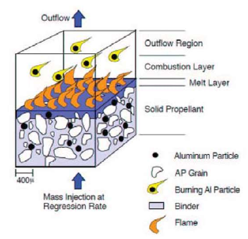

# Composite Propellants  
*Created on:* 2024-11-28 
*Tags:* #CompositePropellants #HTPM #PBAN
*Course:* [[Rocket Propulsion]]

---
## Definition
*Heterogenous propellant with a solid crystalline oxidizer dispersed in a polymeric fuel (binder)*

- Metal Al powder enhance energy release during combustion.
- *Oxidizer:* 
	- Ammonium Perchlorate (AP) commonly used.
	- Dissociates easily.
	- Lower thermal stability
	- Production of toxic gases.
- *Polymeric Fuels:* The polymer binds together the discrete crystalline oxidizer.
	- *PBAN:* Polybutadiene Acrylic Acid Acrylonitrile. Linear and cross-chains, lower ultimate tensile strength. Used for larger rockets.
	- *HTPB:* Hydroxy terminated Poly Butadiene. High performance in propellant.
	- *GAP:* Glycidyl Azide Polymer, contain high $H_{2}$ % and provide high performance.
- *Metals:* used as fuel as metal combustion is highly exothermic.
- They have higher densities, [Specific Impulse] and wider range of burning rates.  
- At higher pressure => higher chemical kinetics => higher burn rate.
- Wetting agents and burn rate modifiers are used to ensure proper bonding and modify the burn rate.

## Burn Rate Evaluation 

$$
r = \frac{k_{g}\left[\frac{T_{f} - T_{s}}{X^*}\right]}{\rho_{p} [c(T_{s} - T_{i} + q]}
$$

- $r$ increases when $T_{i}$, $T_{f}$ increase and $X^*$ decreases.
- At low pressure, premixed flame controls burning.
- At higher pressures, diffusion flame dominates.

