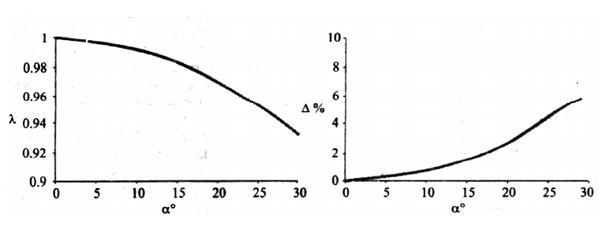

# Divergence Loss  
*Created on:* 2024-11-28
*Tags:* #DivergenceLoss
*Course:* [[Rocket Propulsion]]

---
## Definition

*Divergence loss coefficient:* ratio between the momentum of the gases entering in a conical nozzle to the momentum of an ideal nozzle with all gases flowing in axial direction.

$$
\lambda = \cos^2\left( \frac{\alpha}{2} \right)
$$

The fractional loss of thrust $\Delta$ is the difference between 1 and $\lambda$.

