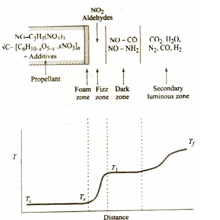
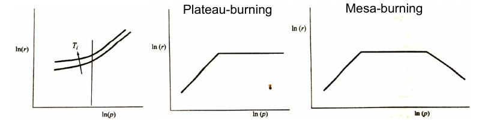

# Double-base Propellants 
*Created on:* 2024-11-28
*Tags:* #doublebasePropellants
*Course:* [[Rocket Propulsion]]

---
## Definition
*Comprises of Nitrocellulose (NC) and nitroglycerine (NG) mixed together at the molecular level to form a homogenous propellant grain*

- Both NC and NG have fuel and oxidizer in them and can be used singly as propellant - *single base propellant*.
- NC and NG used together constitute *double base propellant*.

## Mechanism of Burning

## Burn rate evaluation

General expression for burn rate in a double-base propellant is given as

$$
r = ap^n
$$

Where,
- *a:* Temperature coefficient, depends on the initial temperature, composition and other characteristics of the propellant.
- *p:* pressure
- *n*: pressure exponent/combustion index.

### Influence of initial temperature on burn rate

$$
\Pi_{r} = \frac{1}{r} \frac{dr}{dT}|_{p} 
$$

Fractional variation in r due to unit temperature change at constant pressure.

$$
r = r_{T_{0}}e^{\Pi_{r}(T-T_{0})}
$$

$T_{0}$ is the reference temperature and $r_{T_{0}}$ is the burn rate at that temperature.

By convention the chamber pressure is non-dimensionalized with reference to 7 MPa

$$
r = r_{7MPa}\left(\frac{P}{7}\right)^n
$$
Where $P$ is in MPa.

### Choice of index n for stable operation.

Operating point is stable if the pressure and mass flow rate are stable in time.

$$
P_{eq} = \left(aC^* (\rho_{p} - \rho_{g}) \frac{S_{b}}{A_{t}}\right)^\frac{1}{1-n}
$$
Where,
- $P_{eq}$ is the equilibrium pressure.
- $C^*$ is the [[Characteristic Velocity]].
- $\rho_{p}, \rho_{g}$ are the density of propellant and gas.

For stable operation, $n<1$ or $n <\frac{1}{1 - \frac{\rho_{g}}{\rho_{p}}}$

### Factors effecting Burn Rate

- *Variation of burn rate with size of rocket:*
	- Variation in size of rocket changes the radiation and convection rate.
	- Thus, variation in burn rate even for same pressure.
	  
- *Erosive burning with long propellant grains*
	- Increase in propellant burning rate due to high velocity of the combustion gases flowing parallel to the burning surface.
	- Leads to shear force and heat transfer.
    
- *Burn rate enhancement with acceleration*
	- Accelerates the flame towards burning surface by centrifugal forces.