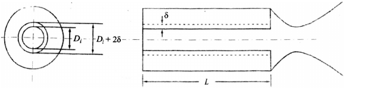

# Hollow Cylindrical Grain  
*Created on:* 2024-11-28
*Tags:* #HollowCylindricalGrain #ProgressiveBurning #grainClassfication 
*Course:* [[Rocket Propulsion]]

---

## Variation of Cylindrical Grain

Using the pressure relation from [[Double-base]].

*Initial chamber pressure*
$$
p_{c,i} = \left (aC^* \rho_{p} \frac{\pi L D_{i}}{A_{t}}\right)^\frac{1}{1-n}
$$

*Final chamber pressure*

$$
p_{c,f} = \left (aC^* \rho_{p} \frac{\pi L (D_{i}+2\delta)}{A_{t}}\right)^\frac{1}{1-n}
$$

*Mean burn rate*

$$
\bar{r} = a \left( \frac{p_{c,i} + p_{c,f}}{2}\right)^n
$$

*Time taken*
$$
\Delta t = \frac{\delta}{\bar{r}}
$$ 

## Burn Time

For $n \ne 0.5$,
$$
t_{b} = \frac{1-n}{2(1-2n)aA^n} \left[ D_{f}^\frac{1-2n}{1-n} - D_{i}^\frac{1-2n}{1-n}\right]
$$

For $n = 0.5$,
$$
t_{b} = \frac{1}{2aA^n} \ln\frac{D_{f}}{D_{i}}
$$
