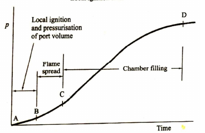

# Ignition System  
*Created on:* 2024-11-28 
*Tags:* #ignitor #solidMotor
*Course:* [[Rocket Propulsion]]

---
## Definition
*Igniter in a solid rocket motor generates the heat and gas required for motor ignition.*

**Required Properties:**
- Fast high heat release
- Stable initiation and operation over wide pressure ranges
- Rapid initiation of igniter propellant
- Low ignition delays
- Low burn rate sensitivity to temperature and low value of n.
- Easy to manufacture, transport and handling.
- Long life
- Minimum moisture absorption or degradation with time.

**Mounting Options**
- Aft, Internal
- Aft, external
- Forward, internal
- Forward, external

Most suitable is the *Forward, internal* since,
- It can be thrown out after burnout as it is a deadweight.
- The ignitor gas travels from forward to aft and back, better chance of combination.

**Types of Igniter**

- *Ignitor Composition*
	- By combustion of an easily burnable mixture.
- *Pyrotechnic Igniter*
	- Combustion of the igniter charge is initiated electrically.
- *Pyrogen Igniter*
	- A small solid propellant rocket is used as igniter.
	  
**Ignition Process**
- Receipt of an electrical signal which includes heat generation.
- Transfer of heat from igniter to motor grain surface.
- Spreading flame over the entire burning surface area.
- Port volume filling with gas.
- Chamber pressure elevation.

*Phase I, Ignition time lag:*
Time from the moment igniter receives a signal to the first grain burning.

*Phase II, Flame-spreading interval:*
Flame spread from local ignited area till complete grain burning area.

*Phase III, Chamber-filling interval:*
Time for completing the chamber filling process and for reaching the equilibrium chamber pressure and flow.

