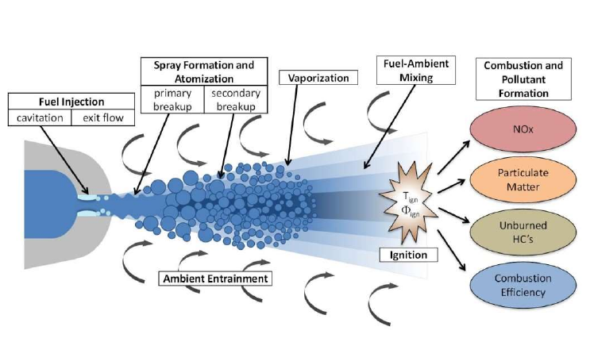

# Injector  
*Created on:* 2024-11-28  
*Tags:* #injector
*Course:* [[Rocket Propulsion]]

---
## Definition
*Injector has the following functions, *
- Introduce and meter the flow of liquid propellants into the combustion chamber.
- Atomization
- Improve mixing of fuel and oxidizer
- Types:
	- Pressure atomizing
	- Gas-assist injectors
	  
### Atomization

### Pressure Atomizing Injectors
Liquid fuel and oxidizer are supplied at high pressure to the injector to form high velocity liquid jets.

**Showerhead Injector**
- A series of slender parallel jets of liquid fuel and oxidizer are formed from a number of holes provided in an injector.
- Poor mixing
- Not very efficient atomization.
  
$$
MR = \frac{n_{ox} C_{d,ox} A_{ox} \sqrt{ 2\Delta p_{ox} p_{ox}}}{n_{f} C_{d,f} A_{f} \sqrt{ 2\Delta p_{f} p_{f}}}
$$

**Impinging Jet Injectors**
- High velocity jets are made to impinge on each other and form liquid sheets, which then break up into fine droplets.
- Multiple configurations
	- Doublets
	- Triplets
	- Quadruplets

*Doublets*
- Jet A and Jet B impinge with each other and form a fan perpendicular to the plane.
- Orientation of fan depends on the impingement angle of jets and their respective momentum.

$$
\tan \beta = \frac{\dot{m_{2}}V_{2}\sin \alpha_{2} - \dot{m_{1}}V_{1}\sin \alpha_{1}}{\dot{m_{2}}V_{2}\cos \alpha_{2} + \dot{m_{1}}V_{1}\cos \alpha_{1}}
$$

- *Impinging Jet Like Propellant:* Jet A and Jet B exhaust either propellant or oxidizer.
- *Impinging Jet Unlike Propellant:* Jet A and Jet B exhaust exhaust fuel and oxidizer respectively.
  
**Coaxial Injectors**
- Annular liquid spray fans are formed by injecting the liquid fuel and liquid oxidizer coaxially.
- Sheets formed are coaxial and can be impinging/non-impinging.

### Gas-assist injectors
- Uses high velocity gaseous medium to atomize the liquid fuels or oxidizers.
- Aerodynamic shear arising from the gas flow over the liquid causes the droplets to be formed.

### Factors influencing injector behavior

- *Propellant combination:* A design generally doesn't work for all propellant combinations.
- *Orifice pattern and Orifice Size:* Performance is dependent on orifice size, angle of impingement, number of orifices, distribution of orifices, etc.
- *Transient Conditions*
- *Hydraulic Characteristics:* Injection velocity depends on the orifice type and pressure drop across the orifice.
- *Heat Transfer*
- *Structural Design*
- *Combustion Stability* 

