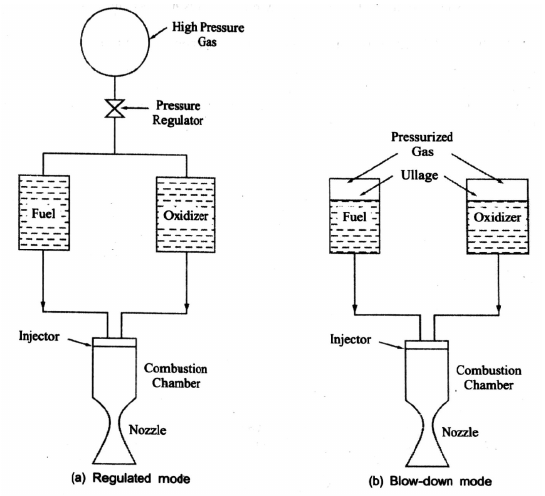
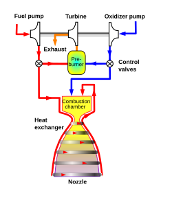
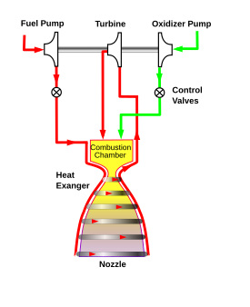
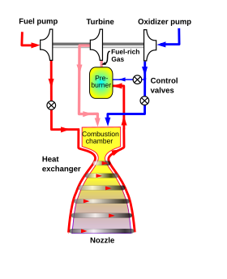
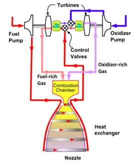

# Propellant Feed System  
*Created on:* 2024-11-28
*Tags:* #propellantFeedSystem 
*Course:* [[Rocket Propulsion]]

---
## Definition
*The functions of the propellant feed systems are given as follows,*
- To raise the pressure of the propellants.
- To feed the propellants at predicted mass flow rates to one or more thrust chambers.

**Types:**
- Gas pressure feed system
	- Gives superior performance when total impulse/mass of propellant is low.
- Turbopump feed system
	- Superior performance when total impulse/chamber pressure is large.

**Gas pressure feed system**
- Propellants forced out of their respective tanks by displacing them with high pressure gas.
- Types:
	- *Regulated:* uses a gas pressure regulator in the gas feed line and the engine operates as constant tank pressure and nearly constant thrust.
	- *Blow-down:* The gas or vapour column above the liquid surface is directly pressurized. 

| Criteria        | Regulated                                 | Blow-Down                                                    |
| --------------- | ----------------------------------------- | ------------------------------------------------------------ |
| Pressure/Thrust | Constant                                  | Decreases as propellants is consumed                         |
| Gas Storage     | High-Pr tanks                             | Stored inside propellant tank with large ullage volume       |
| Components      | Regulator, filter, gas valves and tank    | Larger, heavier propellant tanks                             |
| Advantages      | Constant F, $I_{sp}$                      | Simple system, less gas required                             |
| Disadvantages   | More complex, pressure drop at regulators | Less accurate mixture control. $I_{sp}$ decreases with time. |

**Turbopump feed system**
- Pumps used for supplying propellants from the tanks into the combustion chamber.
- Enormous power requirements.
- Pumps are usually driven by turbines which derive power from expansion of warm gases.

*Engine Cycles:* It describes the specific propellant flow path through the major engine components.

- *Gas Generator:* 
	- Open Cycle
	- Some fuel and oxidizer is used to run the turbine and some used for combustion after cooling the nozzle.
	- Pre-burner is used to heat the fuel and oxidizer before sending to turbine.
	  
- *Expander:* 
	- Closed Cycle.
	- All fuel used for cooling of nozzle, to operate turbine and then passed to CC.
	  
- *Staged:* 
	- Closed Cycle. 
	- Combination of Gas Generator and Expander.
	  
- *Full Stage Combustion Cycle:*
	- Full flow of both propellants through the turbines.
	- Separate turbine used for fuel and oxidizer.
	- Full gasification of each propellant before entering the combustion chamber.
	- Turbine runs cooler and at lower pressure.
	- Increased engineering complexities due to two preburners and two turbines.

