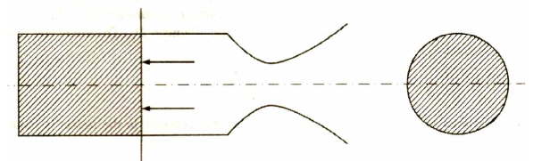
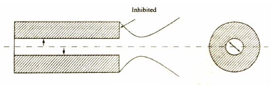
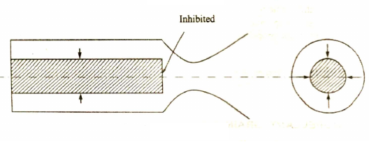
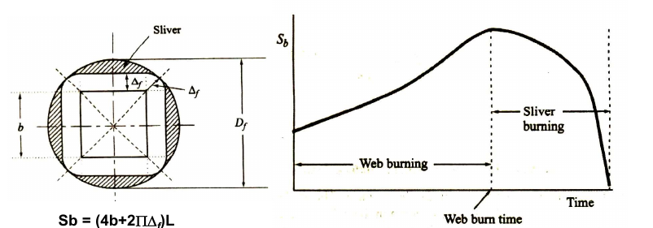

# Propellant Grain Classification  
*Created on:* 2024-11-28
*Tags:* #grainClassfication
*Course:* [[Rocket Propulsion]]

---
## Definition
*Types of grain classification are as follows*
- *Neutral Burning:* [[Rocket Thrust]] and Chamber Pressure doesn't vary with time.
  
- *Progressive Burning:* [[Rocket Thrust]] and chamber pressure increase with time. Example, [[Hollow Cylindrical Grain]].
  
- *Regressive Burning:* [[Rocket Thrust]] with chamber pressure decreases with time.
  

## Web Burning and Silver

- *Web Thickness:* Minimum radial width of the propellant grain.
- *Silver:* Unburned propellant remaining at the time of web burnout.
- *Burn time:* Time taken for burning of the web.
- *Action time:* time taken between pressure of 10% of the initial web pressure and 10% of the final web burn pressure.

