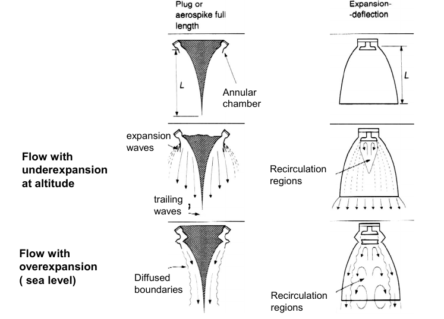

# Types of Nozzles 
*Created on:* 2024-11-28 
*Tags:* #TypesofNozzles #BellNozzle #TVC #ExtendibleNozzle #DualBellNozzle
*Course:* [[Rocket Propulsion]]

---
## Definition

The different types of nozzles are listed as follows,

- *Contour/Bell Nozzle:* Larger initial angle and small exit angle.
	- Shaped as a bell and keeping the length to be small.
	- $\alpha_{i}=20^{\circ}-50^{\circ}$ 
	- $\alpha_{e}=2^{\circ}-5^{\circ}$ 
	- $\alpha_{i} - \alpha_{e}$ : Turn-back angle
	- Larger area ratio can be used.
	- Reduction in overall length.
	  
- *Thrust Vectoring Nozzle (Single):* 
	- Mechanical deflection of nozzle
	- Insertion of heat-resistant bodies into exhaust jet.
	- Injection of fluid into the side of diverging nozzle section.
	- Separate thrust producing devices.
- *Thrust Vectoring Nozzle (Multiple):* Differential throttling with four fixed position thrust chambers.
- *Extendible Nozzle:* The nozzle consists of an extensible segment and the nozzle length can be extended.
- *Dual Bell Nozzle:* Consists of a dual-bell nozzle which allows it to work on lower and higher altitude than its design point.

- *Expansion Deflection Nozzle:* 
	- It has a plug inside the annular throat.
	- Length of plug < Length of nozzle.
	- Allows altitude compensation.
- *Plug/Aerospike Nozzle:* 
	- It has a spike shaped plug inside the nozzle.
	- Length of plug > Length of nozzle.
	- Helps in altitude compensation.
	  
