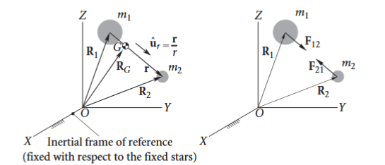
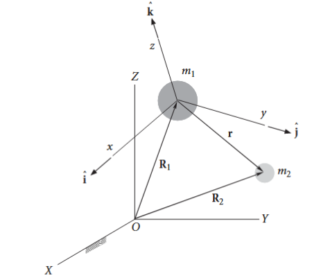

# Central Force Motion 
*Created on:* 2025-01-03  
*Tags:* #CentralForceMotion
*Course:* [[Space Dynamics]]

---
## Equations of motion in an inertial frame

- A system with two point mass under the influence of gravity observed from an inertial frame of reference.
- The frame of reference may move with a constant speed, but the axes don't rotate (otherwise acc. will be there and frame is non-inertial).

$$\vec{R_{G}} = \frac{m_{1}\vec{R_{1}} + m_{2}\vec{R_{2}}}{m_{1}+m_{2}}$$
$\vec{R_{G}}$ is the position vector of the center of mass of the system. The velocity and acceleration of $G$ is given as
$$\vec{R_{G}'} = \frac{m_{1}\vec{R_{1}'} + m_{2}\vec{R_{2}'}}{m_{1}+m_{2}}$$
$$\vec{R_{G}''} = \frac{m_{1}\vec{R_{1}''} + m_{2}\vec{R_{2}''}}{m_{1}+m_{2}}$$
The magnitude of force of gravitational attraction between $m_{2}$ and $m_{1}$ is given as
$$
F_{21} = F_{12}= \frac{Gm_{1}m_{2}}{r^2}
$$
By Newton's third law, $\vec{F_{12}} = -\vec{F_{21}}$ while $\vec{F_{12}} = m_{1}\vec{R_{1}''}$ and $\vec{F_{21}} = m_{2}\vec{R_{2}''}$. Thus, $m_{1}\vec{R_{1}''} + m_{2}\vec{R_{2}''} = 0$.

Therefore, the acceleration of the center of mass $G$ of the system is zero. It moves with a constant velocity in a straight line.

## Equations of relative motion

Let us define the position vector of $m_{2}$ relative to $m_{1}$ as $\vec{r}$ where
$$
\vec{r} = \vec{R_{2}}-\vec{R_{1}}
$$
Now,
$$
m_{1}m_{2}(\vec{R_{2}''}-\vec{R_{1}''}) = -\frac{Gm_{1}m_{2}}{r^2} (m_{1}+m_{2}) \hat{u}_{r}
$$
i.e.
$$
\vec{r''} = - \frac{G(m_{1}+m_{2})}{r^2} \hat{u}_{r}
$$
Assuming $\mu = G(m_{1}+m_{2})$, we get
$$
\ddot{\mathbf{r}} = -\frac{\mu}{r^3} \mathbf{r}
$$
This second order differential equation governs the motion of $m_{2}$ relative to $m_{1}$.

In the moving frame $xyz$, the relative vector $\mathbf{r}_{rel}$, relative velocity $\dot{\mathbf{r}}_{rel}$ and relative acceleration $\ddot{\mathbf{r}}_{rel}$ is given as
$$
\mathbf{r}_{rel}= x \hat{i} + y \hat{j} + z \hat{k}
$$$$
\dot{\mathbf{r}}_{rel}= \dot{x} \hat{i} + \dot{y} \hat{j} + \dot{z} \hat{k}
$$$$
\ddot{\mathbf{r}}_{rel}= \ddot{x} \hat{i} + \ddot{y} \hat{j} + \ddot{z} \hat{k}
$$
Whereas in absolute frame,
$$
\dot{\mathbf{r}} = \dot{\mathbf{r}}_{rel} + \Omega \times \mathbf{r} 
$$
$$
\ddot{\mathbf{r}} = \ddot{\mathbf{r}}_{rel} + \dot{\Omega} \times \mathbf{r} + \Omega \times(\Omega \times \mathbf{r}) + 2\Omega \times \dot{\mathbf{r}}_{rel}
$$

## Angular Momentum

The angular momentum of body $m_{2}$ relative to $m_{1}$ is the moment of $m_{2}$ 's relative linear momentum $m_{2}\mathbf{\dot{r}}$
$$
\mathbf{H}_{2/1} = \mathbf{r} \times m_{2}\mathbf{\dot{r}}
$$
Now, h is the relative angular momentum of $m_{2}$ per unit mass, that is specific relative angular momentum.
$$
\mathbf{h} = \mathbf{r}\times \mathbf{\dot{r}}
$$
Taking the time derivative, 
$$
\frac{d\mathbf{h}}{dt} = \mathbf{\dot{r}}\times\mathbf{\dot{r}} + \mathbf{r}\times\mathbf{\ddot{r}}
$$
Now, cross multiplication of a vector with itself is zero and $\mathbf{r}\times\mathbf{\ddot{r}}$ can be written as
$$
\mathbf{r}\times\mathbf{\ddot{r}} = \mathbf{r} \times \left(-\frac{\mu}{r^3} \mathbf{r}\right) = 0
$$
Thus, 
$$
\frac{d\mathbf{h}}{dt} = 0
$$
i.e. the specific relative angular momentum is constant and 

