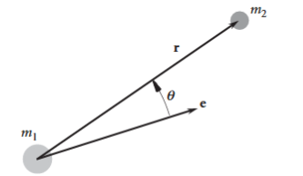
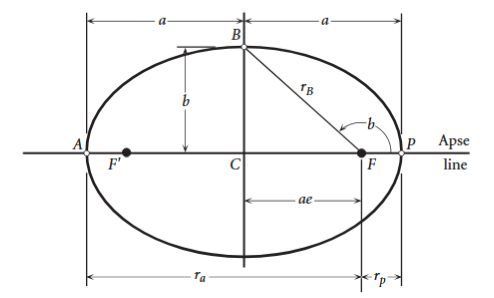
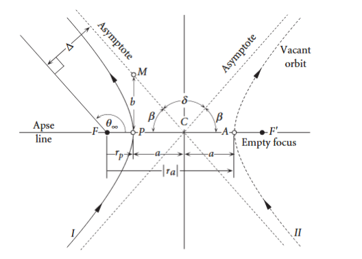

# Trajectory and Orbital Period 
*Created on:* 2025-01-03  
*Tags:* #Trajectory #OrbitalPeriod
*Course:* [[Space Dynamics]]

---
## Orbit Equation
$$
r = \frac{h^2}{\mu} \frac{1}{1+e\cos \theta}
$$

For a given orbit $h,\mu,e$ are constants where as the position of 

$$
\mathbf{h} \cdot \mathbf{e} = 0
$$
The angular momentum vector is always perpendicular to the eccentricity vector.

We know the component of velocity tangent to the orbit $(v_{\perp})$ is given as 
$$
v_{\perp} = r \dot{\theta}
$$
Whereas $h=r^2\dot{\theta}$, then $v_{\perp} = \frac{h}{r}$. Therefore,
$$
v_{\perp} = \frac{\mu}{h} (1+e\cos \theta)
$$
Since, $v_{r} = \dot{r}$, we have
$$
v_{r} = \frac{\mu}{h} e\sin \theta
$$

The flight path angle $\gamma$ is given as
$$
\tan \gamma = \frac{v_{r}}{v_{\perp}}
$$

The total mechanical energy per unit mass $\varepsilon$ is given as
$$
\frac{v^2}{2} - \frac{\mu}{r} = \varepsilon = -\frac{1}{2} \frac{\mu^2}{h^2}(1-e^2)
$$

## Circular Orbit ($e=0$)

- Constant $r$
- Constant time-period $T$
- $v=v_{\perp}$

$$r = \frac{h^2}{\mu}$$
$$
T = \frac{2\pi h}{\mu} = \frac{2\pi}{\sqrt{\mu}} r^{1.5} 
$$
$$
\varepsilon = -\frac{1}{2} \frac{\mu^2}{h^2}
$$
## Elliptical Orbit ($0<e<1$)

- Peri --> Close, $\theta=0$, $r_{p}$
- Apo --> Away, $\theta=180$, $r_{a}$
- $2a = r_{a}+r_{p}$
- $b = a\sqrt{1-e^2}$
- $T = \frac{2\pi}{\sqrt{ \mu }}a^{1.5}$
- $\frac{r_{p}}{r_{a}} = \frac{1-e}{1+e}$
- $e = \frac{\text{distance between the foci}}{\text{length of the major axis}}$

## Parabolic Orbit ($e=1$) 

- $\varepsilon$ = 0
- $v = \sqrt{\frac{2\mu}{r}}$
- As $\theta \rightarrow 180^{\circ}$, $r \rightarrow \infty$ and $v \rightarrow {0}$
- Parabolic paths are known as escape trajectories, since the mass escapes from the influence of gravity of the host and never returns.
- Hence, the escape velocity for the trajectory is given as
$$
v_{esc} = \sqrt{\frac{2\mu}{r}} = \sqrt{2}v_{o}
$$
Where $v_{o}$ is the speed of a satellite in a circular orbit of radius $r$.

## Hyperbolic trajectories ($e>1$)

- The system consists of two symmetric curves.
- One of them is occupied by the orbiting body while the one is its empty, mathematical image.
- $r \rightarrow \infty$ for $\theta = \cos^{-1}(-1/e)$
- Periapsis lies on the apse line on the physical hyperbola.
- Apoapsis lies on the apse line on the vacant hyperbola.
- The asymptotes of the hyperbola intersect at C which is the center of the hyperbola. They make an acute angle with the apse line, where $\beta=180^{\circ}-\theta_{\infty}$
- The angle $\delta$ between the asymptotes is called the turn angle. 
$$
\delta = 2 \sin^{-1}(\frac{1}{e})
$$
- $\Delta=b=a\sqrt{ e^2 -1 }$

