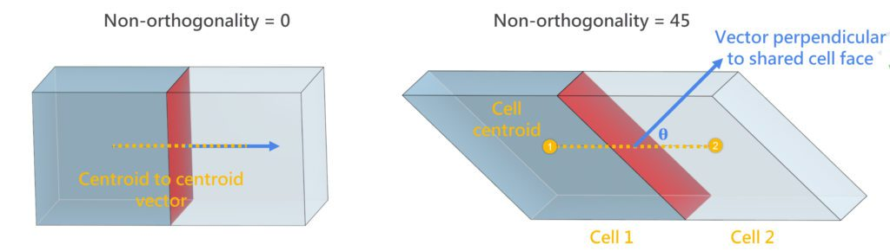

# Mesh Quality 
*Created on:* 2024-12-26  
*Tags:* #MeshQuality
*Course:* [[Pointwise]]

---

## Orthogonality

It is the angle between two cell centers and the normal vector to the shared face between them.

Larger Angle ==> More skewed cells ==> Worse mesh quality

## Skewness

Skewness is the normalized distance between a line that connects two adjacent cell centroids and the distance from that line to the shared face’s center.

More Skewness ==> Worse mesh quality

1. **Equiangle Skew:** Deviation from isotropic triangle to an anisotropic triangle.
2. **Centroid Skew:** Similar to orthogonality

## Area/Volume Ratio

Should be kept low for better mesh.

## Aspect Ratio

Ratio of minimum edge length to the maximum edge length.

## Min/Max Angle
