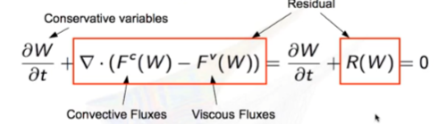
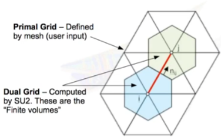

# High-level source code overview 
*Created on:* 2024-12-26  
*Tags:* #SourceCodeOverview
*Course:* [[SU2]]

---

## Governing Equations

**Navier-Stokes Equations**

Governing equation form of Navier-Stokes for steady flow problem.

At each iteration the solver will
1. Compute $R(W)$
2. Compute an update to $W$ to drive $R(W) \rightarrow 0$

## Primal v/s Dual Grids

The initial grid made in any meshing software is known as the *Primal Grid*, whereas the grid computed by SU2 as finite volumes is known as *Dual Grid*.

*Face:* The face of finite volume where the integrals are computed.

## Finite Volume Method

The GDE is integrated over a finite volume $\Omega_{i}$
$$
\int_{\Omega_{i}}\frac{\partial W}{\partial t}\, d\Omega + \int_{\Omega_{i}} \nabla (F^c(W) - F^v(W))\, d\Omega = 0
$$
Using Green-Gauss theorem to convert to boundary integral, which is equal to the the $R(W)$.

## Computing convective flux

- Solution data stored at points $i$ and $j$
- Flux needed at face
- Desirable properties for a scheme to compute the flux
	- Stable
	- Upwinding
	- Capture shocks
	- Low dissipation in smooth regions
	- High-order accuracy
- SU2 implements
	- JST
	- Roe
	- HLLC
	- AUSM

## Computing viscous fluxes

- How to compute gradients ?
	- Green-Gauss
	- Weighted Least Square
- This gives gradients at each point $i$ and $j$.
- For gradients at the face
	- Use finite difference to compute the gradients parallel to $ij$
	- Use Corrected Average Gradient

## Time-stepping

- Explicit: $W$ computed at current time step
- Implicit: $W$ computed at the next time step
$$
\frac{|\Omega^n_{i}|}{\Delta t_{i}^n} \Delta W_{i}^n = -R_{i}(W^{n+1})
$$
Solved using Taylor-series approximation.
- Solution strategies:
	- FGMRES
	- Bi-CGSTAB
	- Acceleration via Preconditioners

