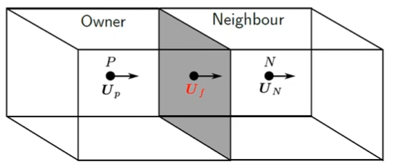
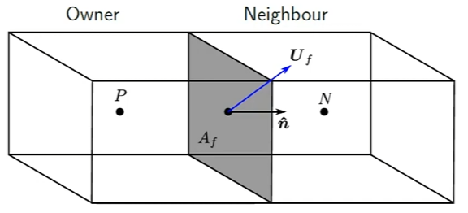

# Finite Volume Method 
*Created on:* 2025-01-18  
*Tags:* #FVM
*Course:* [[SU2]]

---
## Motivation

- To convert the PDE (Navier Stokes Equation) to a system of linear equations and solve it using a linear solver.

## Finite Volume Method

- Steady Incompressible N-S Equations
$$
\nabla \cdot (UU) = -\frac{1}{\rho} \nabla p + \nabla \cdot (\nu \nabla U) + g
$$
- Discretize the equation using a generic 3D polyhedral cell.
- In the second order FVM, the flow variable vary linearly across the cells.
- The values are computed at the cell centroid.
- Each cell will have M neighbors due to M faces of the 3D polyhedral cell.

### Integration

- We integrate the N-S equation across the cell
$$
\int_{V}\left[ \nabla \cdot (UU) + \frac{1}{\rho} \nabla p - \nabla \cdot (\nu \nabla U) - g \right]\,dV = 0
$$
- We can integrate each term separately.

### Source Term

- Constant source terms (like gravity) are easy
$$
\int_{V} [g]dV = gV_{p}
$$
- The gravity force is added to the right hand side (to the $B$ vector).
- Linear source terms require more care.
- Assume that the source terms $SU$ was added to the Navier Stokes equations.
$$
\int_{v} [SU]\,dV = S_{p} \int_{V} U dV = S_{p} \int_{V} (U_{p}+(x-x_{p})*(\nabla U_{p}))dV = S_{p}U_{p}V_{p}
$$
- We could either add $-S_{p}V_{p}$ to the $M$ matrix or add $S_{p}U_{p}V_{p}$ to the $B$ matrix.

### Implicit and Explicit Treatment

- Adding the source term to the $M$ matrix is called implicit treatment.
- Adding the source term to the $B$ matrix is called explicit treatment.
- The treatment of source term is dependent on the sign of the source term as it will either improve the $M$ matrix dominance (if negative) or reduce (if positive).

## Convection Term

- These terms contain the divergence operator ($\nabla \cdot$).
- The divergence theorem is used to convert the volume integrals into surface integrals.
$$
\int_{S} F \cdot \hat{n}\, dS
$$
- The convection term is written as
$$
\int_{V} [\nabla \cdot UU]\,dV = \int_{S} [U(U\cdot \hat{n})]\,dS
$$
- The dot product of the velocity, the unit normal vector and the surface element is the volume flow rate out of the surface. 
- The other velocity outside the bracket $(U)$ is the unknown we are solving for.
- The velocity is transported by the volume flux.
- The surface integral into a sum over a finite number of faces.
$$
\int_{S} [U(U\cdot \hat{n})]\,dS = \sum_{i=1}^M \int_{S} [U_{i}(U_{i}\cdot \hat{n}_{i})]\,dS_{i}
$$
- We can approximate as the value at the face center $f$.
$$
\sum_{i=1}^M \int_{S} [U_{i}(U_{i}\cdot \hat{n}_{i})]\,dS_{i} \approx \sum_{i=1}^M [U_{fi}(U_{fi}\cdot \hat{n}_{fi})]\,S_{i}
$$
- We need the value at the face centers $(f)$ and we only have the centroid values $(P,N)$.
- Interpolation is needed.

- Variety of face interpolation schemes to calculate $U_{f}$:
	- Upwind
	- Second-order/linear Upwind
	- Central Differencing
	- QUICK
- The convection term is now
$$
\int_{V} [\nabla \cdot UU]\,dV \approx \sum_{i=1}^M U_{fi} F_{fi}
$$
- The convection terms leads to diagonal and off-diagonal terms.
- This is a reflection of the cell connectivity. 

## Face Interpolation Schemes

### Linear/Central Differencing

- Linear variation between the centroids.
- Second order accurate (due to the linear variation).
- Scheme is unbounded (prone to oscillations).
- Central differencing is used for the diffusion term.
- Should never be used for the convection term in a RANS solver.
- Although, it can be used for the convection term in LES.
$$
\psi = \frac{|x_{f}-x_{P}|}{|x_{N}-x_{P}|}\,\,\, \text{such that}\,\,\, \psi \in[0,1]
$$
$$
\phi_{f} = \psi\,\, \phi_{N} + (1-\psi)\,\, \phi_{P}
$$
### Upwind Differencing

- Depends on the direction of the mass flux
$$
F_{f} = \rho_{f} A_{f}(U_{f}\cdot \hat{n})
$$
- $F_{f}>0$ indicates the mass flow out of the cell.
- $F_{f}<0$ indicates the mass flow into the cell. 

- The value of $\phi$ on the cell face ($\phi_{f}$) is given by:
$$
\phi_{f} = \begin{cases}
\phi_{p} & F_{f}>0\\
\phi_{N} & F_{f}<0
\end{cases}
$$
- The $\phi$ is constant between the cell centroid and the cell face.
- It is a first-order accurate. It alters the flow properties and hence not accurately calculated.
- But it is the most stable scheme for convection dominated flows.

### Linear Upwind Differencing

- Popular scheme
- More accurate than upwind differencing (Second Order Accurate)
$$
\phi_{f} = \begin{cases}
\phi_{p}+(\nabla \phi)_{P} \cdot r & F_{f}>0\\
\phi_{N}+(\nabla \phi)_{N} \cdot r  & F_{f}<0
\end{cases}
$$
- We use the gradient $\nabla \phi$ to improve the accuracy of the extrapolation.
- The variation between the cell centroid and the face is linear.
- It is popular for the convection term but not for the diffusion term.
- However, we often have to limit the gradient $(\nabla \phi)_{P}$ to prevent local maxima/minima.
- Gradient Limiter ($\varphi$) and $\varphi \in[0,1]$.

### Advanced Discretization Schemes

- Combination of Linear/Central Differencing $(\phi_{CD})$ for accuracy and Upwind Differencing for stability ($\phi_{UD}$).
$$
\phi_{f} = \Psi\,\,\phi_{OD} + (1-\Psi)\,\,\phi_{CD}
$$
- $\Psi$ is a blending function to switch between schemes.
- The schemes pick clear ways to choose $\Psi$.

