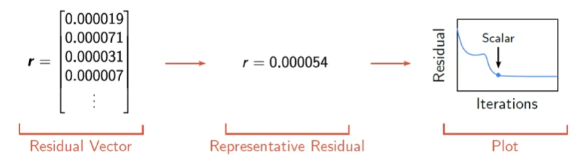

# Residuals 
*Created on:* 2025-02-28  
*Tags:* #Residuals
*Course:* [[SU2]]

---
## Definition

- Each PDE is broken down into $AX=B$. 
- Each row in this matrix represents the conservation equation for each cell. 
- For an non-converged solution, there is an imbalance in the conservation equation. This is handled by addition of an extra term known as *residual*.
$$
AX + B = r
$$
- To calculate the residual for a current iteration, we use the solution for the current iteration into the above equation.
- The closer $r$ is to zero, the more accurate the current solution.

$$
A_{p}T_{p} - \sum_{Cell} a_{nb}T_{ab} - B_{p} = r_{p}
$$
## Assessing Convergence

- The residual vector will never become exactly zero.
- However, if the residual vector is sufficiently small, then we can stop the calculation and use the solution for post-processing.
- The residual vector is a scalar field which can be visualized through a contour plot but it is not practical to access the contour plot for every iteration.

## Representative Residual

- It is useful to have a single value that is representative of the residual in all the cells.
- A single value is easier to track every iteration with a line plot.

- The representative residual is calculated differently by different CFD codes.
- All of the definitions are based on the one of the following norms
	- $L_{1}$ norm - Provides equal weighting to all components.
	- $L_{2}$ norm - RMS
	- $L_{\infty}$ norm - The maximum absolute value.
- To remove this dependency on the length of the vector N. redefine the different definitions of the representative residual:
$$
r = \frac{||r||_{2}}{N^{0.5}}
$$
## Scaling

- The scaled residual is defined as the percentage of quantity lost/gained in the cell.
$$
r_{s} = \frac{r}{n}
$$
- $n$ is the scaling factor.
- We can calculate the scaling factor in two ways:
	- Manual calculate the scaling factor. This is cumbersome and is not possible for all problems.
	- General Scaling Factor: The scaling factor is calculated using the product of diagonal elements of the $A$ matrix and a representative $\Delta T$
	- The temperature difference is not explicitly expressed how it is being calculated.
- The reduction in the order of magnitude of the scaled residual is used to assess the convergence, not the exact value.

## Normalization

- There is no matrix equation for continuity equation, hence it is treated same as the other transport/conservation equations.
- Rather than scaling the mass imbalance, the mass imbalance is normalized instead.
- We divide the mass imbalance by the maximum value to normalize it and understand the orders of reduction.
$$
r_{norm} = \frac{r}{max(r)}
$$
- Scaling and normalizing lead to quite different values.
- It is common to use the maximum value from the first 5 iterations for normalization.
$$
r_{norm} = \frac{r}{max_{\text{ 5 Iterations}}(r)}
$$
- If the solution diverges, then the maximum mass imbalance keeps increasing.
- This is why the maximum value for normalization is often taken over the first five iterations.

