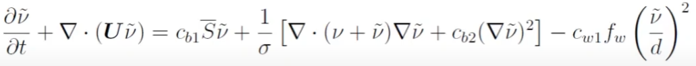
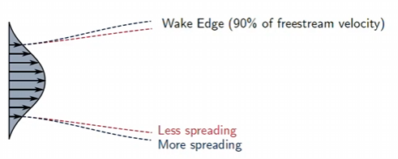

# Spalart-Allmaras Model 
*Created on:* 2024-12-30  
*Tags:* #SAModel #TurbulenceModelling
*Course:* [[SU2]]

---
## History

- The turbulent/eddy viscosity is computed using RANS turbulence models.
- $k-\epsilon$ model is not accurate at predicting boundary layers with adverse pressure gradients.
- A better model is required for aerodynamics and turbomachinery.

## Spalart-Allmaras Model

### Behavior of  turbulent viscosity near the wall for a flat plate ?

- In the logarithmic region ($y^+ >30$), the variation of $\nu_{t}$ is linear.
$$
\frac{\nu_{t}}{\nu} = \kappa y^+
$$
- Near the wall in the viscous sub-layer, the profile varies with $(y^+)^4$
- A lot of cells close to the wall is required as flow quantities is varied linearly.

### Spalart-Allmaras Variable

- A new variable $\tilde{\nu}$ is solved instead of $\nu_{t}$. It is similar to $\nu_{t}$.
- It is straight line everywhere for a flat plate boundary layer with no pressure gradient.
- It is easier to solve numerically.
- A transport equation for $\tilde{\nu}$.
- Once, we have solved for $\tilde{\nu}$, we can calculate for $\nu_{t}$ 
$$
\nu_{t} = \tilde{\nu}f_{v1},\,\,\,\, f_{v1} = \frac{X^3}{X^3 + c^3_{v1}}, \,\,\,\, X=\frac{\tilde{\nu}}{\nu}
$$
- This function $f_{v1}$ captures much of the viscous damping effects.

### SA Transport Equation

The transport equation for $\tilde{\nu}$ is given as 

- LHS is the temporal derivative and convective term.

#### Turbulence Generation

- Represented by the first term of RHS.
- Turbulence is produced by shear. $S$ is the shear rate tensor.
- It is a positive term.
$$
\mathbf{S} = 0.5(\nabla \mathbf{U} + (\nabla \mathbf{U})^T),\,\,\, S= \sqrt{ \mathbf{S}:\mathbf{S}}
$$

#### Diffusion of Turbulence

- Most transport equations contain a diffusion term of the form $\nabla \cdot (\Gamma \nabla \phi)$
- 2nd term of RHS. 
- The diffusion term also has an additional non-linear term ($c_{b_{2}}(\nabla \tilde{\nu})^2$).
- The value of $c_{b2}$ was calibrated to 0.622 to get a more accurate spreading of the wake profile.
- The non-linear term is often referred as source term.
  

#### Destruction of Turbulence

- Last term of RHS.
- Presence of wall destroys turbulence through viscosity and inviscid blocking.
- $d$ is the distance to the nearest wall.
- $f_{w} \rightarrow 0$ as $d \rightarrow 0$ to prevent a divide by zero error.

### Boundary Conditions

1. $\tilde{\nu}=0$ at the wall.
2. In the freestream, $\tilde{\nu} = \nu_{t}$.
$$
\tilde{\nu} = \nu_{t} = \frac{C_{\mu}k^2}{\epsilon}\,\,or\,\, \tilde{\nu} = \nu_{t} =\frac{k}{\omega}
$$
3. $k$ and $\omega$ can be calculated from a length-scale (10% of the aerofoil chord length) and turbulent intensity (5%).
$$
k = \frac{3}{2}U^2 I^2\,\,\, \epsilon = \frac{C_{\mu}k^{1.5}}{l}
$$

