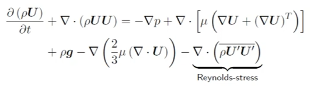

# Turbulence Modelling 
*Created on:* 2024-12-30  
*Tags:* #RANS #TurbulenceModelling
*Course:* [[SU2]]

---
## Reynolds Averaged Navier Stokes 

Replacing the statistical definition of the flow quantities in the Navier-Stokes Equation (Momentum Equation), we get the RANS equations.
$$
A(t) = \bar{A} + A'(t)
$$
Where $A(t)$ is some time-varying quantity and $\bar{A}$ is the time-average of the quantity whereas the $A'(t)$ is the variation of the quantity about the average in time.

The most common approach for modelling the Reynold's stress term is the Boussinesq hypothesis.
$$
-\overline{\rho U'U'} = \mu_{t}(\nabla U + (\nabla U)^T) - \frac{2}{3}\rho kI - \frac{2}{3}(\nabla \cdot U)I
$$
So, $\mu_{t}$ needs to be calculated to close the equations.

### Mixing Length Models

- Older models used a mixing length ($l_{m}$) approach to calculate the eddy viscosity ($\mu_{t}$).
- The wall blocks the maximum size of the eddies.
- Prandtl mixing length hypothesis supposes that 
$$
l_{m} = \kappa y,\,\,\, \kappa=0.41
$$
## Van Driest Mixing Model

- The viscosity in the viscous sub-layer dampens the eddies and reduces their size.

## The scale of turbulence

- The mixing length is specified algebraically, thus is fixed throughout the domain as distance from a geometry is fixed.
$$
\mu_{t} = \rho k^{0.5} l_{m}
$$
- We solve a transport equation for $\epsilon$.
- Instead of $l_{m}$, solve for $\epsilon$ (Turbulence Dissipation Rate):
$$
\mu_{t} = C_{\mu} \frac{\rho k^2}{\epsilon}
$$
Hence, we have the [[k-Epsilon]] model. 

