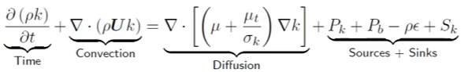
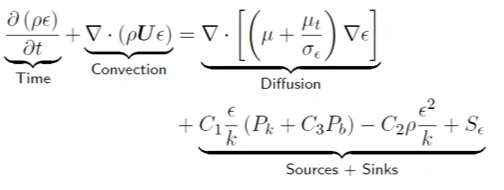
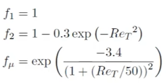

# $k-\epsilon$  Model 
*Created on:* 2024-12-30  
*Tags:* #kepsilonSSTModel #TurbulenceModelling
*Course:* [[SU2]]

---
## Transport Equation for $k$

The transport equation for $k$ (Turbulent Kinetic Energy) is same in all kinds of $k-\epsilon$ models

- $P_{k}$ is the production due to mean velocity shear.
- $P_{b}$ is the production due to buoyancy.
- $S_{k}$ is a user-defined source.

## Transport Equation for $\epsilon$

- The model coefficients $C_{1},C_{2}$ and $C_{3}$ vary between models.
- Once the transport equation for $k$ and $\epsilon$ have been solved, we can compute $\mu_{t}$. This is used to solve the RANS.
- The model coefficients for the standard $k-\epsilon$ model have evolved through time. 

## Damping Functions

- In the mixing length model, the mixing length was damped close to the wall.
- Here, model coefficients $C_{1},C_{2}$ and $C_{\mu}$ are damped.
- The damping functions are termed $f_{1},f_{2}$ and $f_{\mu}$
- This is called a *low-Re formulation*.

- $\mathrm{Re}_{\tau}$ is the turbulent Reynolds number
$$
Re_{\tau}  = \frac{\text{Turbulent Forces}}{\text{Viscous Forces}} = \frac{\rho k^{0.5} l_{m}}{\mu} = \frac{\rho k^2}{\mu \epsilon}
$$
- When $\mathrm{Re}_{T}$ is small, viscous effects dominate and indicates viscous sub-layer.
- The damping function $f_{\mu}$ is applied to every cell in the mesh and is a field.
- We get more dissipation of $k$ near the wall. This is the expected action of viscosity.

## Limitations

- $k-\epsilon$ is not accurate at predicting boundary layers with adverse pressure gradients. The prediction is even worse when shocks are present (supersonic flow).
- A better model is required for aerodynamics and turbomachinery.

Hence, [[k-Omega]] model is used. 
