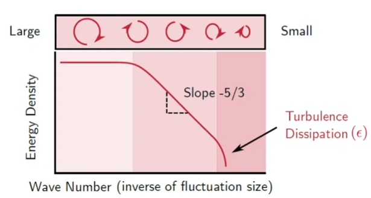
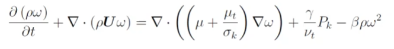
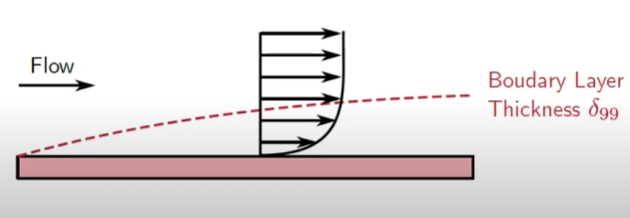
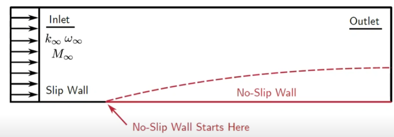

# $k-\omega$  Model 
*Created on:* 2024-12-30  
*Tags:* #komegaSSTModel #TurbulenceModelling
*Course:* [[SU2]]

---
## History

Many turbulence models have been proposed to give better performance in adverse pressure gradients e.g. Spalart-Allmaras, $k-\omega$.

Many different versions of $k-\omega$ model have been proposed.

Most modern version of the $K-\omega$ is by Wilcox (2006). A lot of the details about the versions is given in the website of [NASA Turbulence Modelling Website](https://turbmodels.larc.nasa.gov/wilcox.html) 

## $k-\omega$ Model

$\epsilon$ is the turbulence dissipation rate. It is the rate at which turbulent kinetic energy is converted into thermal energy by the action of viscosity. It occurs at high wave number. Unit is $m^2/s^3$

$$
\epsilon = \nu \overline{\frac{\partial U'_{i}}{\partial x_{j}}\frac{\partial U'_{i}}{\partial x_{j}}}
$$
We don't know $U'_{i}$, so we solve a transport equation to calculate $\epsilon$ directly instead. We expect $\epsilon$ to be high near walls and in shear layers.

$\omega$ is the specific turbulence dissipation rate (1/s).
$$
\omega = \frac{\epsilon}{C_{\mu}k} 
$$
Where $C_{\mu}=0.09$. Both describe the dissipation of turbulent kinetic energy. We can solve a transport equation for either of them.

**Transport equation for $\omega$**

The damping functions used in [[k-Epsilon]] aren't very accurate in the presence of adverse pressure gradients, since they are derived for flat plat with no adverse pressure.

Whereas, $k-\omega$ doesn't need these damping functions. Hence, it is accurate for aerodynamics and turbomachinery than the other one.

## Weakness of $k-\omega$

The model is dependent on the freestream turbulence conditions which is the main weakness of the model.

## Example Problem

- Boundary layer growth over a flat plate.
- $\mathrm{Re}_{\infty} = 10^7$
- $M=0.5$

### CFD Setup

- We specify uniform freestream profiles of $k_{\infty}, \omega_{\infty}$ and $M_{\infty}$.
- The freestream turbulence is negligible. Hence, a very small value of $k_{\infty}$ is chosen.
	- $1e-10$
	- $1e-8$
	- $1e-6$
- This small change should have a negligible effect on the results *(Expectation)*.
- Whereas small value of $k_{\infty}$, influence the flow values largely.
- This will affect the forces on body and flow separation inception.

## Solution to weakness of $k-\Omega$

- The $k-\epsilon$ is not as susceptible to the freestream values.
- Use a blend of $k-\epsilon$ away from the wall and $k-\omega$ close to the wall. 
- This is the basis of $k-\omega$ [SST model](k-OmegaSST.md).