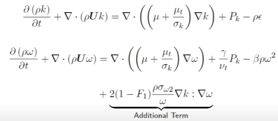
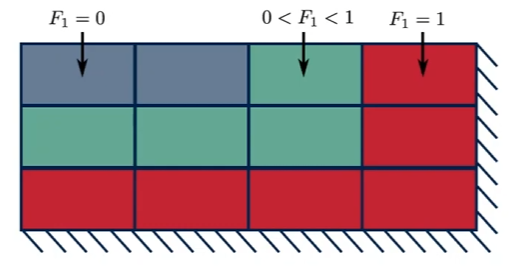

# $k-\omega$ SST model 
*Created on:* 2025-01-01  
*Tags:* #k-omegaSST
*Course:* [[SU2]]

---
## Definition

The $k-\omega$ SST model attempts to address these problems and give better separation prediction.

When $\epsilon=C_{\mu}k\omega$ is substituted into the $k-\epsilon$ model transport equation, an additional term is found as compared to the $k-\omega$ model transport equation.

The additional term is
$$
+ 2\frac{\rho \sigma_{\omega 2}}{\omega} \nabla k:\nabla \omega
$$

If we multiply this additional term by $(1-F_1)$ we can blend between the $k-\omega$ and $k-\epsilon$ models
$$
2(1-F_{1})\frac{\rho \sigma_{\omega 2}}{\omega} \nabla k:\nabla \omega
$$
- If $F_{1}=0$, the model is $k-\epsilon$ 
- If $F_{1}=1$, the model is $k-\omega$ 
- $F_{1}$ is a blending function.

## $k-\omega$ BST equations

The transport equations for the $k-\omega$ BST model are

$$

$$
## The blending function $F_{1}$

- Near the wall, $F_{1}=1$
- Far away from the wall, $F_{1}=0$

$$
F_{1} = \tanh (arg_{1}^4)
$$
-  $\tanh$ is used so that the transition between the models is smooth.
- $arg_{1}$ depends on the distance to the closest wall $d$.
- This is sometimes the same as the wall normal distance $y$.
- It is also used to blend between the empirical constants.

## SST-model

- In the SST model, a viscosity limiter is also included.
$$
\mu_{t} = \frac{a_{1}pk}{\max(a_{1}\omega,SF_{2})}
$$
- The limiter results in better agreement with experimental measurements of separated flow.
- $F_{2}$ is another blending function that is similar to $F_{1}$.
- If $F_{2}$ or $S$ is large, then the viscosity is limited.

$$
F_{2} = \tanh(arg_{2}^2)
$$

- $F_{2}$ also depends on the distance to the closest wall $d$.
- $F_{2}$ is larger when d is small (close to the wall).
- This is best for external aerodynamics or simulations where separation is important due to the viscosity limiter.
- Van-Albada: More suitable and robust for separating flows.
- Venkatakrishnan: More suitable for viscous and turbulent flows. 

## Versions

- Care should be taken to check which variation of the $k-\omega$ SST model, the code uses.
